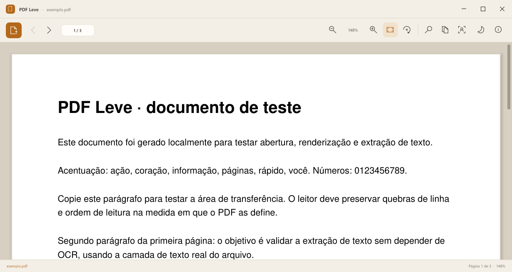
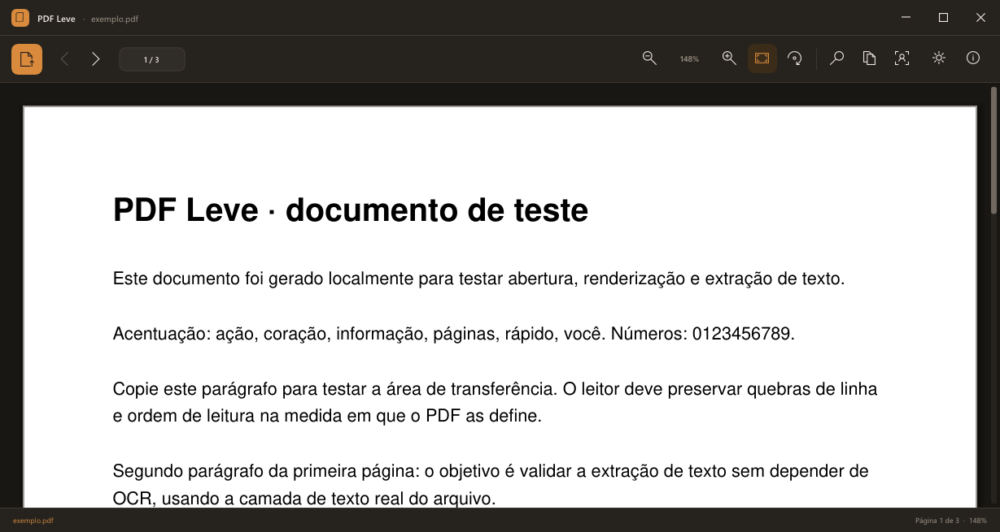

# PDF Leve

Leitor de PDF nativo para Windows, escrito em **C11** com interface **100% cimgui (Dear ImGui)** e renderização **MuPDF**. Leve, rápido e sem distrações.

| Tema claro | Tema escuro |
|---|---|
|  |  |

## Download

Baixe o **PDFLeve.exe** mais recente em [Releases](https://github.com/dnlortega/pdf-leve/releases/latest).

- Windows 10/11 x64
- Executável único e autocontido (~29 MB)
- Sem instalador e sem telemetria
- No primeiro uso, o MuPDF e o runtime VC++ são extraídos para `%LOCALAPPDATA%\PDF Leve\runtime`

## Recursos

- Renderização de PDFs com MuPDF, com zoom, ajuste à largura/página e rotação
- Seleção de texto direto na página e cópia com `Ctrl+C`
- Localizar com `Ctrl+F`, busca sem acentos e destaque dos resultados
- OCR local do Windows para PDFs digitalizados, com cache em disco
- Retomada automática da leitura, lista de recentes e arrastar-e-soltar
- Abertura de PDFs protegidos por senha (com a senha correta)
- Tema claro e escuro
- Janela sem bordas com barra de título personalizada e barra de ferramentas só com ícones

> **Uso responsável:** o PDF Leve não aplica restrições de cópia de documentos que permitem abertura, para facilitar o uso dos seus próprios arquivos. Use esse recurso apenas em documentos que você tem o direito de copiar. O leitor **não quebra senhas** e **não contorna DRM/IRM**; PDFs criptografados exigem a senha correta.

## Atalhos

| Atalho | Ação |
|---|---|
| `Ctrl+O` | Abrir PDF |
| `Ctrl+F` | Localizar no documento |
| `F3` / `Shift+F3` | Próximo / anterior resultado |
| `Ctrl+C` | Copiar seleção (ou o texto da página) |
| `Ctrl+A` | Selecionar a página inteira |
| `Ctrl+Shift+D` | Alternar tema claro/escuro |
| `Ctrl+=` / `Ctrl+-` | Aumentar / diminuir zoom |
| `Ctrl+0` | Zoom 100% |
| `Ctrl+1` / `Ctrl+2` | Ajustar à largura / à página |
| `PgUp` / `PgDn` | Página anterior / próxima |
| `Home` / `End` | Início / fim da página |
| `F1` | Sobre o PDF Leve |
| `Esc` | Fechar modal, busca ou seleção |

O mouse também funciona: roda para rolar, `Ctrl` + roda para zoom e arrastar com o botão esquerdo para selecionar texto.

## OCR

O OCR usa o motor nativo do Windows (`Windows.Media.Ocr`), sem enviar nada para a nuvem. O idioma é `pt-BR` quando instalado, com fallback para qualquer idioma de OCR disponível no sistema.

Os textos reconhecidos ficam em cache em `%LOCALAPPDATA%\PDF Leve\ocr`.

## Compilando

Requisitos:

- Windows 10/11 x64
- [MinGW-w64](https://www.mingw-w64.org/) com GCC e `windres` (testado com w64devkit 16.2.0)
- MuPDF 1.28.2 para Windows x64 (DLLs e headers)

Passos:

1. Coloque `mupdfcpp64.dll`, `msvcp140.dll`, `vcruntime140.dll` e `vcruntime140_1.dll` em `third_party/mupdf/bin/` (veja o README dessa pasta).
2. No Git Bash, execute:

```bash
bash scripts/build.sh
```

3. O executável será gerado em `build/PDFLeve.exe`.

O script procura o toolchain em `../tools/w64devkit/w64devkit/bin`, no `PATH` ou no caminho indicado por `PDFLEVE_TOOLCHAIN`.

## Estrutura

```
src/                    Código-fonte em C (Win32, UI cimgui, MuPDF, OCR, estado)
  gfx.cpp               Camada Direct3D 11
scripts/build.sh        Build com MinGW-w64
scripts/ocr_windows.ps1 OCR local via PowerShell/Windows Runtime
assets/                 Ícone e arquivos visuais
third_party/cimgui      cimgui + Dear ImGui (MIT)
third_party/mupdf       Headers do MuPDF; DLLs não versionadas
tests/                  PDFs sintéticos e testes de integração
docs/                   Capturas de tela
```

## Estado do projeto

Versão **1.0.0**. Ainda não implementados: abas, painel de miniaturas/índice, marcadores/anotações, leitura em voz alta e exportação de PDF pesquisável.

## Licença

Distribuído sob a **GNU Affero General Public License v3.0** (`AGPL-3.0`), em razão do uso do [MuPDF](https://mupdf.com/), que também é AGPL-3.0. Veja [LICENSE](LICENSE) e [THIRD_PARTY_NOTICES.md](THIRD_PARTY_NOTICES.md).

## Autor

**Daniel Ortega Pereira**

- LinkedIn: [linkedin.com/in/daniel-op](https://www.linkedin.com/in/daniel-op/)
- WhatsApp: [+55 (14) 98129-4913](https://wa.me/5514981294913)
